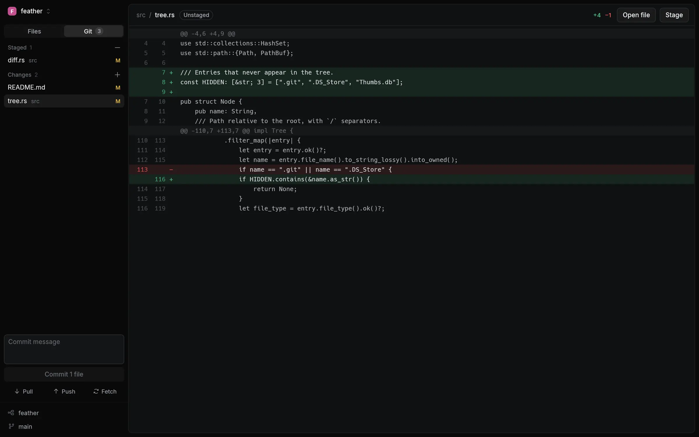

# Feather

A fast, minimal desktop app for browsing a repository and handling everyday git.

**[feather.lh3k.dev](https://feather.lh3k.dev)** · **[Download](https://github.com/Nyaughh/feather/releases/latest)** for Windows, macOS and Linux



- **Files**: a lazy file tree with git status markers; a syntax-highlighted
  editor, rendered Markdown, and image/SVG previews.
- **Git**: staged and unstaged changes, per-file diffs, stage / unstage / discard,
  commit, and pull / push / fetch.
- **Branches and worktrees**: side by side at the bottom-left; click either to
  switch, or type a new name in the branch picker to create one. Branches that
  only exist on the remote are listed too, and Feather fetches every few minutes.
- **Settings**: dark, light or system theme, accent colour, font size, line wrap
  and indentation.
- **Updates**: Feather checks for new releases and can install them itself.

Feather is written in Rust with [egui](https://github.com/emilk/egui). It ships as a
single native binary, only repaints when something changes, and does all disk and
git work off the UI thread.

## Install

Download the build for your computer from the
[latest release](https://github.com/Nyaughh/feather/releases/latest) (on Windows,
`feather-windows-x86_64-setup.exe` is the installer); the
[website](https://feather.lh3k.dev/#install) has the steps for each system.
Feather needs `git` on your `PATH`.

## Building from source

You need a [Rust toolchain](https://rustup.rs).

```sh
cargo run --release            # reopens the last repository
cargo run --release -- ~/code/my-repo
```

The optimized binary is written to `target/release/feather`.

## Shortcuts

`Ctrl` is `Cmd` on macOS.

| Shortcut       | Action                     |
|----------------|----------------------------|
| `Ctrl+O`       | Open a repository          |
| `Ctrl+S`       | Save the file being edited |
| `Ctrl+1` / `2` | Files tab / Git tab        |
| `Ctrl+Enter`   | Commit (in the Git tab)    |
| `Ctrl+B`       | Hide or show the sidebar   |
| `Ctrl+,`       | Settings                   |
| `Ctrl+R`       | Refresh from disk          |

## How it works

| Module        | Role                                                                 |
|---------------|----------------------------------------------------------------------|
| `git.rs`      | Runs the `git` CLI and parses its output (status, diff, branches…).  |
| `worker.rs`   | Background threads; results come back to the UI as events.           |
| `document.rs` | Loads files and syntax-highlights them.                              |
| `diff.rs`     | Parses unified diffs into rows.                                      |
| `tree.rs`     | The lazily-read file tree.                                           |
| `app.rs`      | Application state; applies UI commands and worker events.            |
| `ui/`         | Drawing: title bar, sidebar, editor and diffs, settings, widgets.    |
| `theme.rs`    | Colors, fonts and metrics, for the dark and light themes.            |
| `settings.rs` | Everything the user can change, saved between runs.                  |
| `update.rs`   | Checks GitHub for a newer release and installs it.                   |

Feather shells out to `git` rather than linking a git library, so commits use your
hooks, signing and credential helpers exactly as they do in a terminal.

A background thread re-checks git status and the open file or diff every two
seconds while the window is focused (and immediately when it regains focus). The
window is only redrawn when one of them actually changed.

## Releasing

1. Set the new version in `Cargo.toml` and add a `## <version>` section to
   `CHANGELOG.md`; that section becomes the release notes.
2. Run the **Release** workflow from the Actions tab with that version. It
   builds the three downloads, then creates the tag and the GitHub release.

The website (`site/`, deployed by Vercel) reads releases from GitHub when it
loads, so it picks up a new one without a redeploy. Installed copies find the
release the same way and offer to update, which relies on the download names
(`feather-windows-x86_64.exe` and so on) and `SHA256SUMS.txt` staying the same.

## Tests

```sh
cargo test
```

## Fonts

The bundled [Inter](https://rsms.me/inter/) (SIL Open Font License) and
[Phosphor Icons](https://phosphoricons.com) (MIT) fonts are in `assets/fonts`
alongside their licenses.
